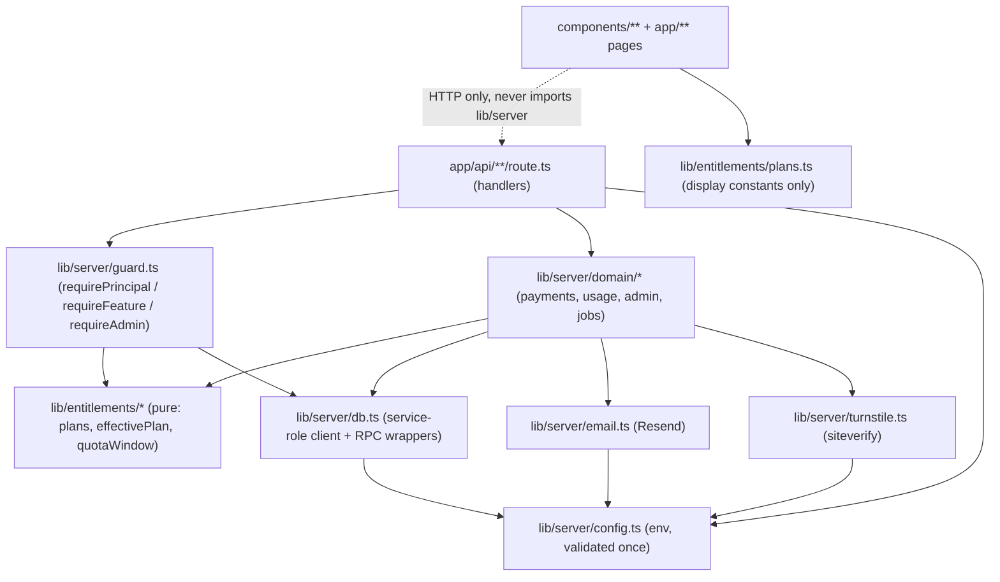
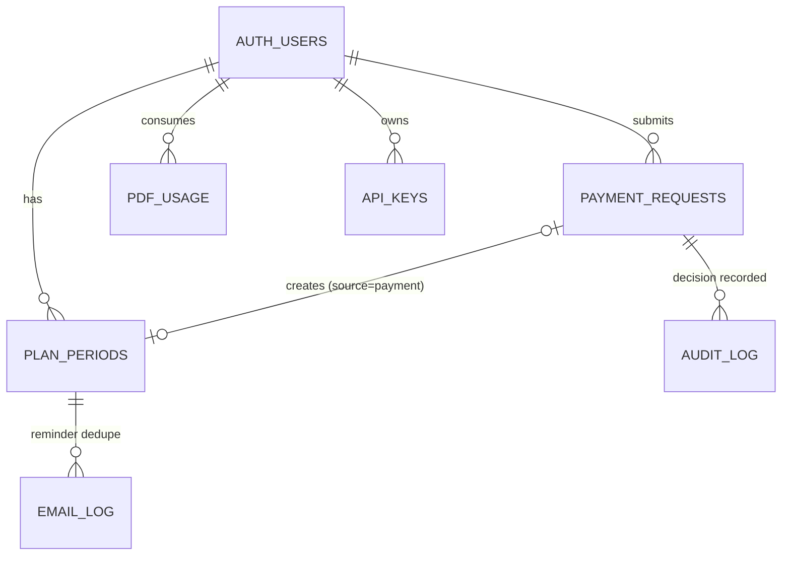
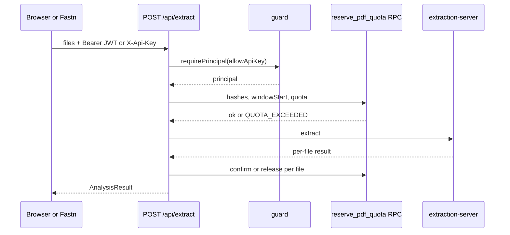

# Architecture Spine — Subscriptions, Manual Payment & Turnstile

## Design Paradigm

**Guard-then-handle.** Every `apps/web/src/app/api/**/route.ts` handler first calls one guard that returns a verified `Principal` and any entitlement it needs, then runs its existing logic. All state that decides access lives in Postgres and is read server-side per request. Pure functions compute entitlement from that state.

Layers, with the only allowed dependency direction:



- `lib/entitlements/` is pure: no I/O, no `process.env`, no clock. `now` is a parameter.
- `lib/server/` is server-only. Nothing under `components/` or client pages imports it (enforced by AD-12).
- Existing `analysis-engine.ts`, `extraction-server.ts`, `approval-form-*` are untouched. Gating wraps them in the route, never inside them.

## Invariants & Rules

### AD-1 — Server-verified identity; every route has a declared guard class

- **Binds:** all `/api` routes; FR-1, FR-2, FR-4, FR-5, FR-11, FR-15
- **Prevents:** a route trusting a user id, plan or admin flag sent by the browser; a new route shipped with no guard; breaking the live token-link and Fastn flows
- **Rule:**
  - The browser keeps its existing localStorage Supabase session [ADOPTED]. `@supabase/ssr` is not adopted. A single client helper `apiFetch` attaches `Authorization: Bearer <access_token>` to every call to `/api/*`.
  - `requirePrincipal(req)` verifies the token with `supabase.auth.getUser(token)` and returns `{ userId, email, via: 'jwt' }`. Missing or invalid token returns 401 `UNAUTHENTICATED`. Identity is never read from the body, query or an unverified claim.
  - Every `route.ts` carries one marker `// guard: <class>` and the test suite fails if a route has none, or if the marker disagrees with the helper actually called. Classes: `jwt`, `feature:chat`, `feature:tender_sheet`, `admin`, `apikey` (jwt or `X-Api-Key`), `token-link`, `cron`, `public`.
  - Existing and new routes:

    | Route | Class |
    | --- | --- |
    | `extract` | `apikey` + quota (AD-5) |
    | `chat`, `doc-answer` | `feature:chat` |
    | `tender-sheet/fill`, `tender-sheet/export` | `feature:tender_sheet` |
    | `ta-form/export-excel` | `jwt` |
    | `approve` GET, `dashboard` GET | `token-link` (unguessable emailed token, unchanged) [ADOPTED] |
    | `dashboard` POST (Fastn) | `token-link` unchanged in v1 (see Deferred) |
    | `fx`, `intake` | `public` |
    | `me/entitlements`, `billing/config`, `payments` (GET own history, POST submit), `payments/[id]/screenshot` | `jwt` |
    | `admin/**` | `admin` |
    | `cron/daily` | `cron` |

  - `doc-answer` is gated as chat because it answers questions about uploaded documents from the chat panel [ADOPTED — founder confirmed].
  - Demo mode: when Supabase env is absent and `NODE_ENV !== 'production'`, the guard returns a synthetic principal on the Max plan. In production, missing Supabase config returns 503 and never a principal.

### AD-2 — API-key principal for the Fastn intake workflow

- **Binds:** `/api/extract`; FR-2; Fastn email-intake
- **Prevents:** the unauthenticated JSON+base64 path becoming a quota bypass; one shared key hiding whose quota is spent; a key principal reading data through a user-scoped client
- **Rule:**
  - `X-Api-Key` is accepted only on `apikey`-class routes. Elsewhere it is ignored and the request gets 401.
  - Keys live in `api_keys(id, user_id, key_sha256, label, created_at, revoked_at)`. The raw key is shown once at creation and never stored or logged. Lookup is by SHA-256.
  - The principal is `{ userId, via: 'api_key' }` and goes through the same quota path (AD-5). One key maps to one user. Creation and revocation are admin-only (`POST /api/admin/api-keys`, no UI in v1).
  - An api-key principal never gets a user-scoped Supabase client. Its reads and writes go through service-role helpers that take `principal.userId` as a required argument.

### AD-3 — Entitlement is a non-overlapping, append-only period ledger

- **Binds:** FR-1, FR-3, FR-9, FR-10, FR-12, FR-15, FR-16
- **Prevents:** two modules deriving "current plan" differently; expiry that depends on a cron; periods that overlap or tie; a renewal backdated into the past; a paid queued plan lost on upgrade
- **Rule:**
  - Table `plan_periods(id, user_id, plan, starts_at, ends_at, source, payment_request_id, created_by, created_at, voided_at)`, `source` is `payment` or `admin`. A row is only ever changed by setting `voided_at`.
  - The database enforces that non-voided periods of one user never overlap (`btree_gist` exclusion constraint on `user_id` and `tstzrange(starts_at, ends_at)` where `voided_at is null`), and `ends_at > starts_at`.
  - `effectivePlan(periods, now)` (TS, `lib/entitlements/`) is the single reader-side definition: the one non-voided period with `starts_at <= now < ends_at`, else Free.
  - The single writer-side definition is the SQL helper `plan_chain_end(user)` = `greatest(now(), max(ends_at))` over non-voided periods, plus the writers in AD-6. Both sides are tested against one shared fixture file `lib/entitlements/cases.json`.
  - Every payment period is 30 days. A new payment for plan P that is not an upgrade appends: `starts_at = plan_chain_end`. This covers same-plan renewal, lower-plan purchase, and renewal after expiry (which then starts now).
  - Upgrade means P ranks higher than the plan effective now. It voids the current period and inserts P starting now for 30 days. Not-yet-started non-voided periods are voided and re-inserted unchanged in length, chained after the new period, so what the user paid for is kept; only the current period's remaining days are forfeited [ADOPTED — founder confirmed 2026-11-11; PRD FR-10 is silent on queued periods].
  - An admin override voids every non-voided period with `ends_at > now` and inserts one period starting now with the given `ends_at > now`; nothing is preserved.
  - Plan quota and feature matrix live only in `lib/entitlements/plans.ts`. USD prices and bank details come from config, not this file.
  - Fallback to Free needs no job: nothing flips at expiry, `effectivePlan` just stops matching.

### AD-4 — One server-side check per request, no caching across requests

- **Binds:** FR-2, FR-4, FR-5, FR-6, FR-12; NFR plan check ≤100 ms p95
- **Prevents:** a stale plan after approval ("no re-login" violated); gating logic copied into each route; client-computed entitlement
- **Rule:**
  - `requireFeature(req, 'chat' | 'tender_sheet')` runs `requirePrincipal`, loads the user's non-voided periods with `ends_at >= now - 62 days` (one indexed query), and returns 403 `PLAN_REQUIRED` with `{ feature, requiredPlan }` when `plans.ts` denies it.
  - `getUser` runs once per request and the principal is passed down, never re-verified per helper. If this breaks the 100 ms NFR, move to local JWT verification as a new AD.
  - Plan state is not cached in memory, in a cookie, in the JWT or in `user_metadata`.
  - The UI learns the plan only from `GET /api/me/entitlements` (plan, expiry, ordered `queued` list with start dates, used, quota, reset date). It is display-only; the server re-checks every action.

### AD-5 — Quota is reserved, confirmed or released through one Postgres function

- **Binds:** FR-2, FR-3, FR-6, FR-16
- **Prevents:** concurrent uploads both passing a count-then-insert check; failed extractions burning quota; the gate and the usage display using different windows; stale window parameters after a plan change
- **Rule:**
  - `quotaWindow(periods, now)` in `lib/entitlements/` returns `{ periodId, plan, quota, windowStart, resetAt }` and is the only window definition, used by the gate and `/api/me/entitlements`. Only non-voided periods count.
    - Paid: the 30-day cycle containing `now`, counted from the period's `starts_at`; `resetAt = min(cycle end, ends_at)`.
    - Free: `windowStart = max(riyadhMonthStart(now), latest ends_at of any non-voided period that ended in this month)`; `resetAt` is the next Riyadh month start. Riyadh time (UTC+3, no DST) appears only in this module.
  - Table `pdf_usage(id, user_id, file_sha256, status, window_start, created_at)`, status `reserved` or `confirmed`.
  - `/api/extract` flow:
    1. Call `reserve_pdf_quota(user, file_hashes, window_start, quota, expected_period_id)`. It takes the per-user lock of AD-6, returns `STALE` if the user's effective period id differs from `expected_period_id` (the route recomputes once and retries), and counts `confirmed` rows with `created_at >= window_start` plus `reserved` rows younger than 10 minutes.
    2. Hashes are de-duplicated inside the batch. A hash with any `confirmed` row for that user, ever, costs nothing (re-analysis, FR-2). If the remaining quota is smaller than the number of new hashes, the whole batch is rejected: 429 `QUOTA_EXCEEDED` with `{ plan, quota, remaining, resetAt }`.
    3. Run extraction.
    4. Per file, success calls `confirm_pdf_usage` (always succeeds, even if the reservation expired), failure calls `release_pdf_usage`.
  - The purchase-requisition file is never counted. Every quotation file counts, whatever its format [ADOPTED — founder confirmed].
  - Quota is enforced only in `/api/extract`. No client-side count is authoritative.

### AD-6 — Plan writes and payment decisions are transactional functions under one per-user lock

- **Binds:** FR-8, FR-9, FR-10, FR-11, FR-12, FR-15
- **Prevents:** half-applied approvals; double decisions; approval and admin override both inserting "starts now" periods; unaudited plan changes; two code paths computing dates
- **Rule:**
  - Table `payment_requests(id, user_id, plan, amount_usd, transaction_id, screenshot_path, status, decided_by, decided_at, reject_reason, created_at)`. `status` is `pending`, `approved` or `rejected`; the latter two are terminal.
  - A partial unique index allows at most one `pending` row per user; a second submit returns 409 `PENDING_REQUEST_EXISTS`. `transaction_id` has a non-unique index and the duplicate flag is derived at read time; it never blocks a submission.
  - `decide_payment_request(request_id, admin_email, decision, reason)`, `admin_set_plan(user_id, plan, ends_at, admin_email)`, and `reserve_pdf_quota` all begin with `pg_advisory_xact_lock` on the same key derived from the user id. Deciding an already decided request returns 409 `ALREADY_DECIDED`.
  - `decide_payment_request` is the only writer of `status` and of `source = 'payment'` periods; `admin_set_plan` is the only writer of `source = 'admin'` periods. Each writes its `audit_log` row in the same transaction and applies the AD-3 rules.
  - `amount_usd` is copied from config at submission and not recomputed at decision.
  - `audit_log(id, actor_email, action, subject_user_id, subject_id, detail jsonb, created_at)` is append-only and written only inside these functions.

### AD-7 — Admin is an allowlisted email pinned to a user id

- **Binds:** FR-11, FR-15, FR-19; `/admin`, `/api/admin/*`
- **Prevents:** an admin check done only by hiding UI; someone signing up with an admin address and becoming admin while email confirmation is off
- **Rule:**
  - `requireAdmin(req)` runs `requirePrincipal` and requires both: the lower-cased verified email is in `ADMIN_EMAILS`, and the user id is in `ADMIN_USER_IDS`. In production, an empty `ADMIN_USER_IDS` makes every admin request 403. The id pin is what makes the allowlist safe whether or not Supabase email confirmation is on.
  - `ADMIN_EMAILS` is also the recipient list for admin notifications.
  - The `/admin` page redirect is a courtesy; every `/api/admin/*` route calls `requireAdmin`. Target user ids are parameters only; the acting identity always comes from the principal.
  - The Admin Page shows each user's current plan for support triage (FR-19).

### AD-8 — Payment screenshots are private and handled by one route

- **Binds:** FR-8, FR-11; NFR privacy and 12-month retention
- **Prevents:** public screenshot URLs; orphaned uploads when submission fails; unvalidated files stored
- **Rule:**
  - Private bucket `payment-proofs` created in `0005`, object path `<user_id>/<request_id>.<ext>`. No storage policy for `anon` or `authenticated`; browsers never read or write it.
  - `POST /api/payments` (multipart) in order: guard, Turnstile (AD-9), validate plan, transaction id, file type (PNG/JPG/PDF by magic bytes) and size ≤ 5 MB, upload with the service-role client, insert the request. If anything fails before the request row commits, the object is removed. Email (AD-10) happens only after commit and never removes the object.
  - The submitting user and admins view a screenshot only via a server-minted signed URL (60-second TTL) after it checks the principal owns the request or is an admin.
  - The retention job (AD-11) deletes objects older than 12 months and nulls `screenshot_path`. The request row stays.
  - Plans and bank data reach the browser only through `GET /api/billing/config` (jwt). `BANK_DETAILS` and `PLAN_PRICES_USD` are never `NEXT_PUBLIC_*`.

### AD-9 — Turnstile: native for auth forms, one custom verifier for payment

- **Binds:** FR-17, FR-18; signup, login, forgot-password, payment form
- **Prevents:** an auth form that works without a token; a second hand-rolled verifier; fail-open on a Cloudflare outage
- **Rule:**
  - Signup, login and password reset pass the widget token as `options.captchaToken`, with CAPTCHA enabled for Turnstile in the Supabase project. Those three flows get no custom verifier.
  - The payment route calls `lib/server/turnstile.ts`, the only code that calls `siteverify`: POST with secret and token, and `remoteip` only when the platform provides a trusted single client IP, otherwise omitted. It uses a 5-second timeout. Timeout, network error, missing or invalid secret, or Cloudflare `internal-error` returns 503 `CAPTCHA_UNAVAILABLE`; `missing-input-response`, `invalid-input-response` or `timeout-or-duplicate` returns 400 `CAPTCHA_FAILED`. It never fails open. Cloudflare single-use is eventually consistent, so replay is backstopped by the one-pending-request index (AD-6).
  - A token is used for exactly one submission. The widget resets after every attempt.
  - Logs carry error codes only, never the token or secret.
  - Site key is `NEXT_PUBLIC_TURNSTILE_SITE_KEY`; the secret is server-only. The Supabase dashboard holds its own copy of the secret for the native flow.

### AD-10 — Email is a typed, post-commit, best-effort side effect

- **Binds:** FR-13, FR-14; NFR `EMAIL_FROM`
- **Prevents:** an email failure rolling back a decision; ad-hoc calls to Resend from several routes; admin unaware of lost mail
- **Rule:**
  - `lib/server/email.ts` exposes `sendEmail(template, to, data)` over a closed set of templates: `payment_submitted_admin` (user, plan, amount, admin-page link), `payment_approved` (plan, expiry date), `payment_rejected` (reason, how to resubmit), `expiry_reminder`. Resend is called only here, with `EMAIL_FROM` from config.
  - Callers send only after the database transaction has committed. Every attempt writes `email_log(id, template, to_email, subject_id, status, error, created_at)`.
  - The Resend SDK returns `{ data, error }` and does not throw on API errors, so `sendEmail` checks `error` and records it. A failure is logged and shown on the Admin Page. It never changes a payment or plan outcome, never removes a stored object and never fails the HTTP request.
  - Admin notifications go to every address in `ADMIN_EMAILS`.

### AD-11 — One idempotent daily job, protected by a shared secret

- **Binds:** FR-14, NFR screenshot retention
- **Prevents:** duplicate or historic reminders; a public job endpoint; plan correctness depending on the scheduler
- **Rule:**
  - `GET /api/cron/daily` requires `Authorization: Bearer <CRON_SECRET>` and is the only job entry point. Vercel Cron calls it once a day (`vercel.json` `crons`); Vercel sends `CRON_SECRET` as that header when the variable is set.
  - Tasks, each safe to run twice: (a) expiry reminders, (b) screenshot retention deletion.
  - Reminder: a non-voided period qualifies only when `now < ends_at <= now + 3 days` and no non-voided period starts at or after its `ends_at`. The job first claims it by inserting an `email_log` row with unique `(template, subject_id)` for `expiry_reminder` (`subject_id` is the period id), then sends; a failed send is marked failed and may be retried by a later run while the period still qualifies.
  - The job never changes `plan_periods`; expiry stays computed (AD-3).

### AD-12 — Persistence boundaries, function privileges and secrets

- **Binds:** all new tables and functions; `apps/web/supabase/migrations/`
- **Prevents:** the browser writing entitlement state or calling a plan-writing function; the service-role key reaching the client bundle; migration drift
- **Rule:**
  - New tables (`plan_periods`, `payment_requests`, `pdf_usage`, `api_keys`, `audit_log`, `email_log`) have RLS enabled. Authenticated users may `select` only their own rows of `plan_periods`, `payment_requests`, `pdf_usage`; no `insert`, `update` or `delete` policy exists on any of them. `api_keys`, `audit_log`, `email_log` have no user policy.
  - Every function from AD-3, AD-5 and AD-6 revokes execute from `public`, `anon` and `authenticated`, grants it only to `service_role`, and sets a fixed `search_path`. A migration test greps `0005+` for this on every `create function`.
  - All writes go through the service-role client in `lib/server/db.ts`. `SUPABASE_SERVICE_ROLE_KEY` and every secret is read only in `lib/server/config.ts`. A test fails if anything outside `lib/server/` and `lib/entitlements/` (components, pages, other `lib/`) imports `lib/server/*`.
  - Schema changes are new numbered files `0005_*.sql` onward, idempotent like `0001`, never edits of existing files.
  - Instants are `timestamptz` (UTC), identifiers `uuid`, money integer USD.

## Consistency Conventions

| Concern | Convention |
| --- | --- |
| Naming | Tables `snake_case` plural; server modules `lib/server/<noun>.ts`; pure modules `lib/entitlements/<noun>.ts`; routes `app/api/<noun>/route.ts`; admin under `app/api/admin/<noun>/`. |
| Error shape | Keep the existing `{ "error": "<message>" }` and add `"code"` plus optional fields. Codes: `UNAUTHENTICATED` 401, `FORBIDDEN` 403, `PLAN_REQUIRED` 403, `QUOTA_EXCEEDED` 429, `PENDING_REQUEST_EXISTS` 409, `ALREADY_DECIDED` 409, `CAPTCHA_FAILED` 400, `CAPTCHA_UNAVAILABLE` 503, `VALIDATION` 400 with `fields`. The client branches on `code`, never on message text. |
| Config | `lib/server/config.ts` is the sole reader of `process.env` for new features; it validates once and fails closed in production. New variables go in `.env.example` only: `ADMIN_EMAILS`, `SUPPORT_EMAIL`, `BANK_DETAILS` (JSON), `PLAN_PRICES_USD` (JSON), `RESEND_API_KEY`, `EMAIL_FROM`, `ADMIN_USER_IDS`, `TURNSTILE_SECRET_KEY`, `NEXT_PUBLIC_TURNSTILE_SITE_KEY`, `CRON_SECRET`, `SUPABASE_SERVICE_ROLE_KEY`. |
| Time | All entitlement functions take `now: Date`; tests inject it. Only `lib/entitlements/` knows Asia/Riyadh (UTC+3, no DST). |
| Logging | `console.error('[api/<route>]', ...)` as today. Never log tokens, API keys, secrets, bank details or screenshot URLs. |
| Fixtures and demos | Fake suppliers and fake users only; never Najran Cement data. |
| Tests | Required in `npm test`: entitlement fixtures `cases.json` (AD-3, AD-5); route guard markers (AD-1); import boundary and `revoke execute` grep (AD-12); Turnstile verifier with mocked fetch including timeout (AD-9); `sendEmail` given a Resend response carrying an error (AD-10). The SQL side of `cases.json` is run by hand in the Supabase SQL editor before each deploy that changes `0005+` (no CI exists). |

## Stack

| Name | Version |
| --- | --- |
| Node.js | 22 (Dockerfile `node:22-bookworm-slim`) |
| Postgres extension `btree_gist` | Supabase-provided (enabled in `0005`) |
| Next.js (App Router, route handlers, `output: standalone`) | ^15.5.19 installed (15.5.29 latest 15.x) |
| @supabase/supabase-js | ^2.108.2 installed (2.119.0 latest) |
| Supabase (Postgres, Auth, Storage) | hosted |
| resend | 6.38.0 (new dependency) |
| Cloudflare Turnstile | widget script `challenges.cloudflare.com/turnstile/v0/api.js`; siteverify `v0` |
| TypeScript, tsx test runner | existing |

## Structural Seed

```text
apps/web/
  supabase/migrations/0005_subscriptions.sql      # periods, usage, payments, api_keys, audit, email_log, RPCs, RLS, bucket
  src/lib/entitlements/   # plans.ts, effective-plan.ts, quota-window.ts (+ .test.ts)  — pure
  src/lib/server/         # config.ts guard.ts db.ts email.ts turnstile.ts domain/  — server-only
  src/lib/api-fetch.ts    # client helper adding the Bearer token
  vercel.json             # crons: /api/cron/daily once a day
  src/app/api/            # existing routes + me/entitlements, billing/config, payments (+ [id]/screenshot), admin/{payments,users,api-keys}, cron/daily
  src/app/(app)/plans, account, admin  # pages (UX per companion DESIGN.md / EXPERIENCE.md)
```





Deployment and environments: one production Supabase project and one production deployment of `apps/web`; hosted on Vercel. Local dev runs in demo mode (AD-1). There is no staging or CI; `npm test` and `npx tsc --noEmit` before every commit (AGENTS.md).

Rollout order (each step must finish before the next, or live flows break):

1. Apply `0005`; create the `payment-proofs` bucket; enable `btree_gist`; run the SQL fixtures.
2. Set env vars (`.env.example` documents them). In Resend, verify the sending domain before accepting real payments.
3. In Fastn, mint an API key for the pilot account and make the intake workflow send `X-Api-Key` on its `/api/extract` call. Do not edit `workflow.json` from here; change it in Fastn.
4. Deploy the web code. Until step 3 is done, `/api/extract` rejects Fastn.
5. Seed pilot users on Pro through `admin_set_plan` before any quota is visible to them (SM-C3).
6. Enable CAPTCHA (Turnstile) in the Supabase dashboard only after the widget code is deployed, then smoke-test signup, login and reset, and one with Cloudflare unreachable (expect failure).
7. Add the `crons` entry for `/api/cron/daily` to `apps/web/vercel.json` (once a day) and set `CRON_SECRET` in Vercel.

## Capability → Architecture Map

| Capability / Area | Lives in | Governed by |
| --- | --- | --- |
| FR-1, FR-16 plan default and fallback | `lib/entitlements/effective-plan.ts` | AD-3 |
| FR-2, FR-3 quota and periods | `lib/entitlements/quota-window.ts`, RPC `reserve_pdf_quota`, `/api/extract` | AD-5, AD-2 |
| FR-4, FR-5 chat and tender-sheet gating | `lib/server/guard.ts` in chat and tender-sheet routes | AD-4 |
| FR-6 plan and usage visibility | `/api/me/entitlements`, plans and account pages | AD-4, AD-5 |
| FR-7 plan selection, bank details | `GET /api/billing/config`, plans page | AD-8, Config convention |
| FR-8 payment submission and history | `/api/payments`, bucket `payment-proofs` | AD-6, AD-8, AD-9 |
| FR-9, FR-10, FR-12 renewal, upgrade, activation | RPC `decide_payment_request` | AD-3, AD-6 |
| FR-11 admin review | `/admin`, `/api/admin/payments` | AD-7, AD-6 |
| FR-13, FR-14 emails and reminder | `lib/server/email.ts`, `/api/cron/daily` | AD-10, AD-11 |
| FR-15 manual override | `/api/admin/users`, RPC `admin_set_plan` | AD-6, AD-7 |
| FR-17, FR-18 Turnstile | auth pages (native), `lib/server/turnstile.ts` | AD-9 |
| FR-19 priority support | Admin Page plan column, plans page text | AD-7 |

## Deferred

- **`POST /api/dashboard` hardening:** the Fastn-called POST stays token-only as today. Requiring `X-Api-Key` there waits until the Fastn key exists.
- **API-key admin UI:** v1 creates keys through an admin-only route or SQL. A UI waits until a second intake customer exists.
- **`/api/intake` abuse:** the public CORS proxy can burn the mapped user's quota through Fastn. Rate limiting waits for evidence of abuse.
- **Supabase-native CAPTCHA outage behavior:** GoTrue source indicates fail-closed (transport error becomes 500); confirmed by the rollout step 6 smoke test, not by design.
- **Staging environment and CI:** none exist; adding them is out of scope.
- **Multi-admin, roles, org accounts, card payments, SAR display, admin analytics:** PRD non-goals.
